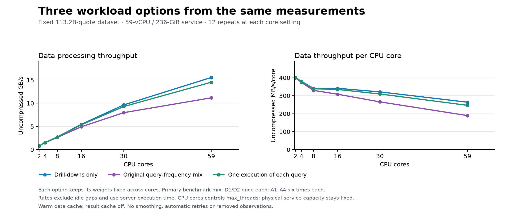
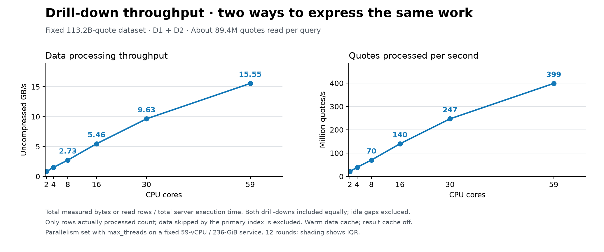
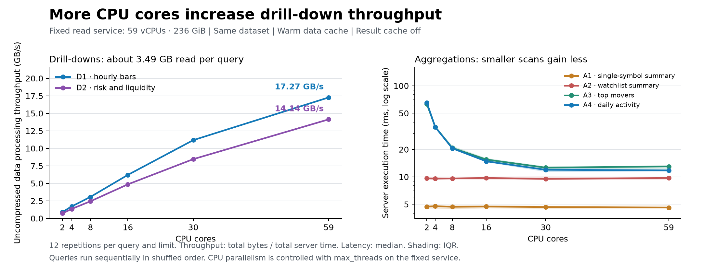
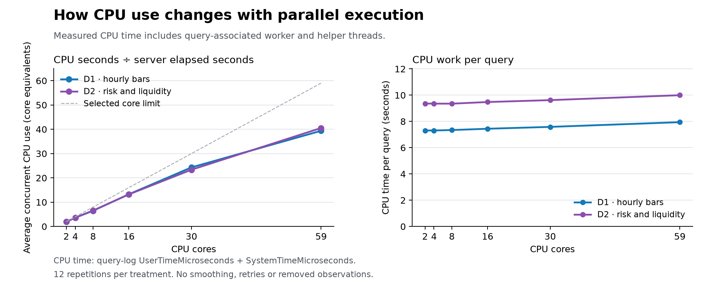

# Reader CPU scaling on a 59-vCPU service: measured findings

The combined drill-down workload rises from **0.80 GB/s at 2 cores to 15.55 GB/s at 59 cores: 19.38× throughput**. From 8 to 16 cores it rises from **2.73 to 5.46 GB/s (2.002×)**. That step is essentially linear; gains taper at the larger core settings.

The measurements support a chart showing strong parallel scaling for these drill-downs. They do not support a claim of perfect linear scaling across every query and all 2–59 core settings. All six core points were measured on one fixed **59-vCPU / 236-GiB** read service, using `max_threads` to control parallelism. They are not six physical service-size measurements.

## Three workload options

Each option keeps the same weights at every core setting. The original-frequency mix remains the benchmark-wide primary result. The drill-down-only subset is a separate, explicitly scoped option for illustrating scan parallelism. The one-of-each mix is a sensitivity check, not a replacement for the benchmark schedule.

| CPU cores | Drill-downs only GB/s | Original-frequency mix GB/s | One of each query GB/s |
|---:|---:|---:|---:|
| 2 | 0.803 | 0.799 | 0.802 |
| 4 | 1.519 | 1.495 | 1.514 |
| 8 | 2.726 | 2.636 | 2.709 |
| 16 | 5.455 | 4.928 | 5.353 |
| 30 | 9.632 | 7.964 | 9.283 |
| 59 | 15.554 | 11.165 | 14.529 |

- Drill-downs only: D1 and D2 once each.
- Original-frequency mix: D1/D2 once each; A1–A4 six times each, matching their original hourly / ten-minute cadence.
- One of each query: equal counts of D1, D2, A1, A2, A3 and A4.

Every rate is weighted total uncompressed read bytes divided by weighted total server execution time. Idle scheduling gaps are excluded. These are rates while queries execute, not sustained ingestion rates or hourly service throughput.

## Recommended drill-down view

Use **CPU cores** on a linear x-axis, with a fixed 113.2B-quote dataset and one combined D1/D2 curve. GB/s aligns with the existing data-processing visual. A rows-per-second version is also valid when it counts rows actually processed.

| CPU cores | Uncompressed GB/s | Million quotes processed/s | MB/s per selected core |
|---:|---:|---:|---:|
| 2 | 0.803 | 20.6 | 401.3 |
| 4 | 1.519 | 38.9 | 379.7 |
| 8 | 2.726 | 69.9 | 340.7 |
| 16 | 5.455 | 139.9 | 341.0 |
| 30 | 9.632 | 247.0 | 321.1 |
| 59 | 15.554 | 398.8 | 263.6 |

The raw table contains **113,217,743,918 quotes**. Each drill-down selects AAPL through the `(sym, t)` primary-key prefix and reads about **89.4M quotes / 3.49GB uncompressed**. It does not scan the entire raw table. Dividing the complete 113.2B dataset by its latency would include index-skipped data in the apparent processing rate. The measured rows/s variant excludes skipped data.

The per-core panel divides throughput by the selected core budget. The existing ingestion-progress visual normalizes by measured CPU work. Those denominators differ and should remain explicit.

### Adjacent core settings

| Change | Core-count factor | Drill-down throughput factor |
|---|---:|---:|
| 2 → 4 | 2.000× | 1.892× |
| 4 → 8 | 2.000× | 1.795× |
| 8 → 16 | 2.000× | 2.002× |
| 16 → 30 | 1.875× | 1.766× |
| 30 → 59 | 1.967× | 1.615× |

The 2→59 span uses 29.5× as many permitted processing cores and delivers about 19.4× drill-down throughput. The larger settings therefore show diminishing returns. The comparison isolates parallelism on the large service; it cannot establish the performance or cost of physically downsizing to a 2-vCPU / 8-GiB node.

## Individual-query evidence

Pooled GB/s and median server execution time; 12 repetitions per cell. Every measured observation is included.

| Query | 8-core GB/s | 16-core GB/s | 30-core GB/s | 59-core GB/s | 8-core latency | 16-core latency | 59-core latency |
|---|---:|---:|---:|---:|---:|---:|---:|
| D1 · hourly OHLCV bars | 3.073 | 6.213 | 11.177 | 17.275 | 1134.670 ms | 561.563 ms | 201.785 ms |
| D2 · risk / liquidity profile | 2.449 | 4.863 | 8.462 | 14.144 | 1424.551 ms | 717.342 ms | 246.624 ms |
| A1 · single-symbol summary | 0.124 | 0.123 | 0.124 | 0.124 | 4.693 ms | 4.719 ms | 4.602 ms |
| A2 · watchlist summary | 0.266 | 0.261 | 0.263 | 0.261 | 9.614 ms | 9.725 ms | 9.721 ms |
| A3 · top movers | 2.017 | 2.745 | 3.372 | 3.301 | 20.785 ms | 15.515 ms | 13.023 ms |
| A4 · daily activity | 3.072 | 4.225 | 5.251 | 5.321 | 20.596 ms | 14.825 ms | 11.783 ms |

A1/A2 already execute in roughly 5–10ms at the smallest tested setting and gain little from extra cores. A3/A4 improve from roughly 63–65ms at 2 cores to about 12–13ms at 30/59 cores. Their timings flatten at the larger settings. This supports calling them already very fast for this workload; it does not prove they are as fast as theoretically possible.

## CPU work

CPU seconds are query-log `UserTimeMicroseconds + SystemTimeMicroseconds`. Dividing by server elapsed time gives average concurrent CPU use in core equivalents. Peak thread usage also includes helper threads and is not a count of busy CPU cores.

| Query / cores | Average concurrent CPU use | Median CPU seconds | GB per CPU second |
|---|---:|---:|---:|
| D1 / 2 | 1.91 | 7.308 | 0.477 |
| D1 / 8 | 6.47 | 7.344 | 0.475 |
| D1 / 16 | 13.27 | 7.442 | 0.468 |
| D1 / 30 | 24.31 | 7.584 | 0.460 |
| D1 / 59 | 39.38 | 7.942 | 0.439 |
| D2 / 2 | 1.93 | 9.361 | 0.372 |
| D2 / 8 | 6.57 | 9.352 | 0.373 |
| D2 / 16 | 13.21 | 9.477 | 0.368 |
| D2 / 30 | 23.36 | 9.622 | 0.362 |
| D2 / 59 | 40.53 | 9.998 | 0.349 |

The substantial scans spread roughly similar total CPU work across more cores, with a modest rise in CPU work at the highest setting. At 59, average query-associated CPU use is about 39–41 core equivalents. The experiment does not isolate the cause of diminishing returns, so it should not attribute them to a particular hardware or scheduling bottleneck.

34 measured A1 observations lack nonzero CPU counters. Their CPU-derived fields are marked unavailable; all latency, byte, row, memory and cache observations remain included. Every D1, D2, A2, A3 and A4 observation has positive CPU counters. The drill-down-only combined CPU figures therefore have complete coverage.

## Same-cap bridge to the 16-vCPU baseline

The lower core settings were repeated on the larger node. The main curve uses only measurements from that node. The bridge records possible host, cache and timing differences rather than assuming exact equivalence.

| Query | New-node / baseline throughput at 8 cores | At 16 cores |
|---|---:|---:|
| D1 | 1.013× | 1.043× |
| D2 | 1.018× | 1.047× |
| A1 | 1.129× | 1.106× |
| A2 | 1.161× | 1.202× |
| A3 | 1.071× | 1.172× |
| A4 | 1.066× | 1.092× |

Exact comparisons for 2/4/8/16 are saved in `derived/cross-node-same-cap.csv`. Both runs used ClickHouse 26.6.1.2292 and identical active benchmark parts. The physical node and memory capacity changed between runs; those differences are preserved in their metadata.

## Validation and environment

- Version **26.6.1.2292**, server timezone UTC. One node, unchanged identity/version with increasing uptime before/after.
- Measured window: **2026-10-11 10:13:31.317108–2026-10-11 10:20:34.280989 UTC**.
- 36 pilot + 36 additional warmup + **432 measured** executions; 12 measured repeats for each of six queries and six core settings.
- **504/504** initial server-query records collected; no failed, missing or duplicate observations, automatic retries or removed outliers.
- All core settings confirmed in query-log Settings; result cache off and no result-cache reads; parallel replicas disabled.
- HTTP read-byte/row counters exactly match query logs. Nanosecond server timings agree with rounded query-log durations.
- Result guards remain non-binding; A3 retains LIMIT 20. FORMAT Null excludes result-transfer time. Client transport wall time is preserved separately.
- Raw and summary table parts, row counts, stored bytes, marks and modification times remain identical before/after and match the baseline.
- 424 asynchronous metric samples per capacity field confirm constant **59 vCPUs / 236GiB** during measurement.
- No measured page-cache misses or object-storage read bytes were recorded; underlying caches were warmed, while the query-result cache stayed disabled.
- 1026 other initial-query records overlap the measured window, with 33.93 reported CPU seconds. Sampled background merge tasks reach 2; the benchmark data parts remain unchanged. The service is not assumed to be otherwise idle.
- Latencies are server execution times on a warm-cache, fixed dataset. This is a controlled parallelism experiment separate from the original active-ingestion benchmark.
- IQRs and paired/bootstrap statistics describe repeat variation in this session. Twelve repeats do not establish a production tail-latency SLA or portability across hosts, datasets and physical tiers.

## Reproduce

See [README.md](README.md) for offline and live commands. `analyze.py`, `combine.py`, `extend_analysis.py`, `report.py` and `plot.py` regenerate findings from saved evidence. SQL, CSV/JSONL, full profile maps, cache counters, service context and file hashes are included. No credentials are included.

Per the ClickHouse `agent-query-safety` rule, queries use readonly access with explicit row, scan and time guards. Per `schema-pk-filter-on-orderby`, saved plans verify the selective `sym` prefix. A3/A4 intentionally scan the complete small maintained summary table within those bounds.

Official references: [max_threads](https://clickhouse.com/docs/reference/settings/session-settings/max-threads#max_threads), [Query complexity restrictions](https://clickhouse.com/docs/operations/settings/query-complexity), [Choosing a primary key](https://clickhouse.com/docs/best-practices/choosing-a-primary-key).
