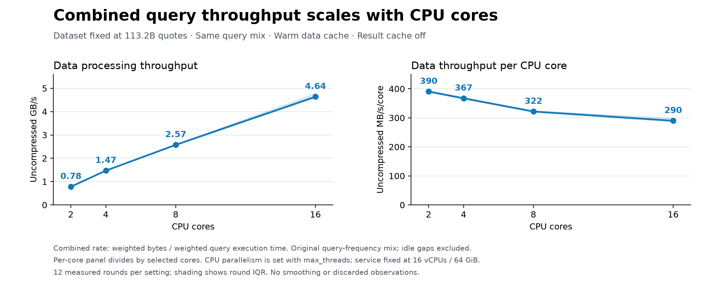
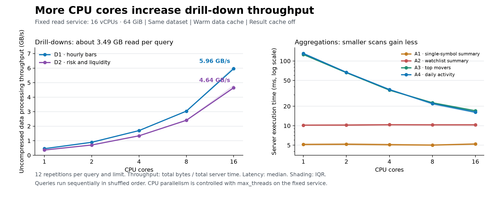
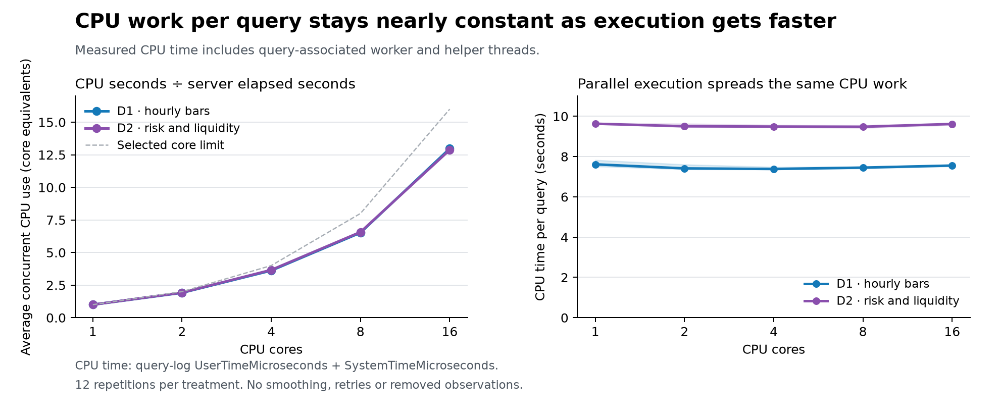

# Reader CPU scaling: measured findings

The combined benchmark workload increased from **2.57 GB/s at 8 cores to 4.64 GB/s at 16 cores: 1.80× throughput**. Both drill-downs individually improved by 1.93–1.96×. This is promising evidence for extending the experiment to the 59-vCPU service.

The improvement varies by query size. A1/A2 already execute in roughly 5–10 ms and gain little from extra parallelism. A3/A4 gain moderately. The data supports strong scaling for the substantial scans; it does not establish perfect linear scaling for the entire mixed workload or predict the unmeasured 30/59-core results.

## Combined workload for the proposed visual

The dataset contains **113,217,743,918 quotes** and is held constant. The visible x-axis is **CPU cores**, with CPU parallelism controlled by `max_threads`. Physical service capacity stays at **16 vCPUs / 64 GiB** throughout this baseline experiment. These points vary query parallelism rather than resizing the service at each point.

The primary combination preserves the original query-frequency mix: D1 and D2 once each per reference hour; A1, A2, A3 and A4 six times each. The 26-query reference cycle is reconstructed from equal numbers of measured repetitions using weights 1,1,6,6,6,6. Idle scheduling gaps are excluded. Combined throughput is weighted total uncompressed bytes divided by weighted total server execution time. It is not an arithmetic mean of the six query rates.

| CPU cores | Combined GB/s | MB/s per selected core |
|---:|---:|---:|
| 2 | 0.781 | 390.4 |
| 4 | 1.469 | 367.2 |
| 8 | 2.573 | 321.7 |
| 16 | 4.637 | 289.8 |

8→16-core combined throughput ratio: **1.802×** (80.2% higher throughput). Relative to an ideal 2× increase, this achieves 90.1% of that increase factor.

The right panel divides throughput by the selected CPU-core limit, so it describes throughput per unit of configured query parallelism. The existing 11a chart derives throughput per busy core from query CPU seconds. Those normalization definitions must be stated consistently in the final blog asset. Exact CPU-normalized drill-down results are also available below; the combined CPU counter has incomplete coverage for 30 tiny A1 observations.

As a sensitivity check, weighting one execution of every query gives 2.66→5.10 GB/s from 8→16 cores (1.92×). These are different workload mixes. The original-frequency mix is the primary result and should remain fixed at every slider setting.

## Individual query results

GB/s is pooled read bytes / pooled server elapsed time. Latency is the median server execution time. Twelve repetitions per cell; every measured observation is included.

| Query | 8-core GB/s | 16-core GB/s | Throughput factor | 8-core latency | 16-core latency |
|---|---:|---:|---:|---:|---:|
| D1 · Hourly OHLCV bars | 3.035 | 5.958 | 1.963× | 1147.264 ms | 574.746 ms |
| D2 · Risk / liquidity profile | 2.405 | 4.642 | 1.930× | 1440.125 ms | 732.608 ms |
| A1 · Single-symbol summary | 0.110 | 0.111 | 1.006× | 5.020 ms | 5.221 ms |
| A2 · Watchlist summary | 0.229 | 0.217 | 0.949× | 10.330 ms | 10.331 ms |
| A3 · Top movers, full summary scan | 1.883 | 2.342 | 1.244× | 22.597 ms | 16.985 ms |
| A4 · Daily activity, full summary scan | 2.882 | 3.871 | 1.343× | 21.976 ms | 16.160 ms |

D1 and D2 each read approximately **3.49 GB uncompressed / 89.4 million rows** from the AAPL key range. This is a drill-down against the full 113.2B-quote dataset, not a scan of all 113.2B quotes. Read-row/byte counts vary by less than 0.01% across caps due to scan granularity; the predicates, active parts and result row counts remain the same.

A1 reads about 0.61 MB; A2 about 2.51 MB; A3 about 42.4 MB; A4 about 63.2 MB. Query planning and final result work are a substantial fraction of the smaller-query timings. Their measured behavior explains why the fixed mixed workload scales less strongly than the drill-downs.

## CPU work and parallelism

CPU seconds = `ProfileEvents[UserTimeMicroseconds] + ProfileEvents[SystemTimeMicroseconds]`. Average concurrent CPU use = CPU seconds / server elapsed seconds. The recorded peak thread count also includes helper threads and should not be equated with busy CPU cores.

| Query / cap | Average concurrent CPU use | GB per CPU second | Median CPU seconds/query |
|---|---:|---:|---:|
| D1 / 1 | 1.00 core equivalents | 0.451 | 7.614 |
| D1 / 8 | 6.52 core equivalents | 0.465 | 7.450 |
| D1 / 16 | 12.97 core equivalents | 0.459 | 7.553 |
| D2 / 1 | 1.00 core equivalents | 0.357 | 9.631 |
| D2 / 8 | 6.57 core equivalents | 0.366 | 9.479 |
| D2 / 16 | 12.87 core equivalents | 0.361 | 9.618 |

The drill-downs perform roughly the same total CPU work while spreading it over more cores. From 8 to 16, average concurrent CPU use roughly doubles and throughput per consumed CPU second changes by only around 1–2%. This is the clearest measured evidence that the scan/aggregation work parallelizes effectively.

Thirty of the 60 measured A1 observations have no nonzero CPU-time counters in their initial query-log record. They retain all measured latency, read-byte, result, cache and memory data. Their per-observation CPU figures are marked unavailable; they are not treated as zero real CPU work. Every D1, D2, A2, A3 and A4 observation has nonzero CPU counters. Complete raw profile maps are preserved.

## Validation and environment

- ClickHouse version: 26.6.1.2292; server timezone UTC.
- 30 pilot + 30 additional warmup + **360 measured** trials. Five caps (1,2,4,8,16); six query definitions; 12 measured repetitions each.
- Measured window: **2026-10-11 09:39:43.143738–09:49:39.578368 UTC**.
- 420/420 server records collected. No failures, missing records, duplicates, result-cache hits, automatic retries or discarded outliers.
- Every requested thread cap is confirmed in query-log Settings. Parallel replicas are explicitly disabled and `max_parallel_replicas=1`.
- Native HTTP-summary row/byte counters exactly match the query-log counters. Nanosecond server elapsed times agree with rounded query-log durations; client wall time is saved separately.
- All result row counts remain below the non-binding 1,000,000 guard. A3 preserves its original LIMIT 20. The output format is Null.
- The active benchmark data parts, row counts, byte counts, marks and modification times match before/after snapshots.
- 597 capacity samples confirm constant 16-vCPU / 64-GiB capacity throughout measurement.
- Result cache off; underlying data/mark/query-condition caches allowed warm. One measured page-cache miss was recorded, with **zero object-storage read bytes**.
- Standard Cloud monitoring and system-table housekeeping continued. There were 1,115 other initial-query records, with 26.70 reported CPU seconds, compared with 1,046.37 reported CPU seconds in the measured workload. Sampled background merge tasks reached 2; benchmark parts stayed unchanged. This was not an otherwise idle service.
- A paired-round bootstrap is saved for 8→16 ratios. These intervals describe repeat variation within this session, not portability across hosts or configurations. Twelve repetitions do not establish a production tail-latency SLA.

## Next test on the 59-vCPU service

After the user completes the resize to 59 vCPUs / 236 GiB, verify stable capacity and warm the data cache. Repeat the full **2,4,8,16,30,59** core sequence on that node, with the same query definitions, result-cache policy, fixed mix and 12 repetitions. Repeating 16 on the new node provides a comparison with this baseline and captures any host/cache changes. Do not combine lower-core points from this node with higher-core points from another node without checking that bridge.

The slider can show **CPU cores** with these six discrete settings. Keep 113.2B quotes fixed and one combined workload line. Save individual-query results for verification even when the blog chart presents only the combined rate.

## Reproduce and inspect

See [README.md](README.md) for offline analysis and live-run commands. The query definitions, exact measured treatment SQL, metadata SQL, CSV/JSONL results, complete profile counters, plots and analysis code are local to this folder. `SHA256SUMS` freezes their content.

The experiment follows the ClickHouse **agent-query-safety** rule (explicit row, scan and time guards; readonly connection) and **schema-pk-filter-on-orderby** rule (existing sym-prefix index use verified in saved EXPLAIN plans). A3/A4 intentionally scan the small full summary table, as authorized by the benchmark workload, with explicit bounds.

References: [Query complexity restrictions](https://clickhouse.com/docs/operations/settings/query-complexity), [Choosing a primary key](https://clickhouse.com/docs/best-practices/choosing-a-primary-key).
